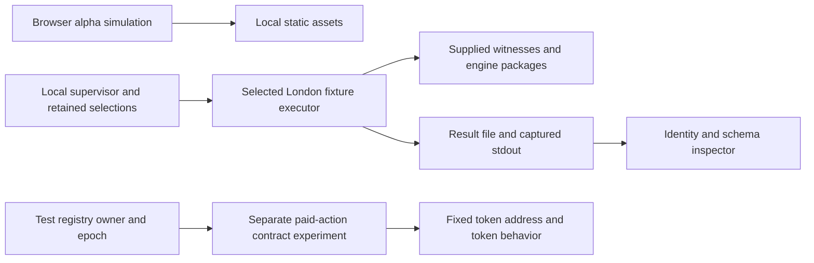

# Current authority and dependency review

Reviewed code: d047704b19898dfa3f13e87bf8e7ac4a92c99f6c, 2026-10-26. [Source identities](../evidence/DEPENDENCY_REVIEW_SOURCES.json) were compared with that Git tree. This is a source review of known current surfaces, not a complete deployed authority graph or a new execution test. FACT denotes observed source behavior; consequences and required successor evidence remain INFERENCE/UNRESOLVED.

## Three distinct surfaces

There is no frontend-to-worker or worker-to-paid-contract integration asserted by this graph. public/deployment.json remains simulation-only, with no chain, contracts, RPCs or wallet connection. The recent worker executes retained local signed transfer/storage fixtures; that does not certify the CAW settlement contract.

| ID | FACT: current source surface | INFERENCE: dependency or authority | UNRESOLVED / replacement evidence |
| --- | --- | --- | --- |
| AD-01 | [Environment](../public/deployment.json) disables wallet and upload access; [server](../server.mjs) binds loopback. | Access to a local page is not access to a deployed protocol. | Independent static build/distribution and an explicitly reviewed connection design. OI-01. |
| AD-02 | [Paid probe](../experiments/paid-action/CawPaidActionProbe.sol) constructor selects immutable registry address/code hash; owner/epoch are read and rechecked around fund-moving operations. | Setup selection remains a trust input. Matching code hash does not authenticate initial ownership or rule out authority in dependencies. | Production registry deployment/state/binding proof and complete dependency graph. OI-04/OI-07. |
| AD-03 | [Test registry](../experiments/paid-action/TestAccountRegistry.sol) constructor assigns IDs1/2 to first and ID3 to second. Owners/approved operators can transfer; epochs change. No later registration mechanism. | Fixture owner allocation is not permissionless username issuance. | Resolve C-001 burn compatibility and registration design before production registration claims. |
| AD-04 | Paid probe _directOwner requires msg.sender to match current owner for deposit/withdraw/stake/unstake; post checks current-owner signature, epoch, nonce, window and distribution. | Transfer permission is distinct from spending. Contract-owner signature behavior remains an external call boundary. | Review actual account modes and signed/withdrawal behavior at the chosen deployment; retained tests are scoped. OI-04/OI-05. |
| AD-05 | Paid probe uses one constant token address and token balance/transfer calls, checking expected balance changes. | Token behavior, chain selection and deployed code are dependencies even without an admin setter in this probe. | Authenticate actual deployment/code/state and supported token semantics. No new chain observation in this review. |
| AD-06 | Paid probe accepts IDs1..3; _allocate loops those IDs, uses fixed FEE, records pool dust and has no dust withdrawal path. | This bounded experiment is not scalable production distribution. No-admin wording cannot erase incomplete economics. | Explicit economics/rounding decisions and scalable design; C-002/C-003 and existing review issue5. |
| AD-07 | [Fixed executor](../experiments/execution-engine/selected-london-executor.mjs) selects London31337/index0; witness inputs are supplied. | Valid commitments are relative to a selected local anchor. | Public chain/fork/finality and trust-anchor policy; independently acquired evidence. OI-02/OI-03. |
| AD-08 | [Supervisor](../experiments/execution-engine/run-owned-executor.py) pins manifests/runtime/guard, generates request ID and observes two child exits. | Supervisor, Python/Windows, filesystem and selected digests remain trusted. | Second-machine/operator reproduction; immutable loading/race review. OI-09. |
| AD-09 | [Output inspector](../reference/executor-output.mjs) compares captured marker/digest; [record inspector](../reference/executor-result.mjs) compares metadata. | A malicious producer/host can forge consistent output. This is not execution authentication. | Independently reproduce outcomes and compare complete state, not just metadata. |
| AD-10 | Retained source selection covers21files plus2executor files; lock/package/entrypoint checks are separately documented. | Not all code actually loaded is attested; registry/runtime distribution can disappear. | Complete portable dependency retention, license/provenance and independent install/rebuild. OI-09. |
| AD-11 | The build has retained fixtures and recovery checks; production transport/media retention is not selected. | A hash cannot recover absent bytes; local backups do not prove independent availability. | Independent surviving copies and retrieval under original-operator loss. OI-03/OI-06. |
| AD-12 | Source/conflict/review records are hosted in a GitHub account; no production release agreement is asserted. | Repository availability and release judgment can still depend on one person. | Independently held source/evidence and explicit public review/release process; no maintainer protocol privileges. OI-08. |

## Priority decision

All OI-01 through OI-09 remain OPEN. The most immediate evidence gap for the current local executor is OI-09: another builder has not reproduced this execution package in an independently controlled environment. The [reproduction handoff](INDEPENDENT_EXECUTOR_REVIEW.md) defines the bounded task. A second invocation by Xubu on the same machine cannot satisfy it.

For production recovery, OI-02/OI-04 remain higher-impact prerequisites: agreed anchor/finality and authentic registry/account authority. They are unresolved design/evidence gates, not fixed by adding another local wrapper or a developer key. Continue the existing [trust model](RECOVERY_TRUST_MODEL.md); do not silently choose a chain anchor or economics. Existing [acquisition issue3](https://github.com/Xubu-Trad/cawmmunity.caw-decentralized-social/issues/3), [reproduction issue10](https://github.com/Xubu-Trad/cawmmunity.caw-decentralized-social/issues/10) and [distribution issue5](https://github.com/Xubu-Trad/cawmmunity.caw-decentralized-social/issues/5) are relevant established lanes; no duplicate issue is created here.

This review closes no gate and claims no new test passes. Public test deployment and production remain blocked.

## Registry/bootstrap detail -- 2026-10-27

[RB-01 through RB-05 and seven open evidence gates](REGISTRY_BOOTSTRAP_REVIEW.md) expand AD-02/AD-03 without changing contract behavior or closing OI-04. Source-derived initial-state ambiguity is distinguished from an executed counterexample, which remains the next bounded experiment.
