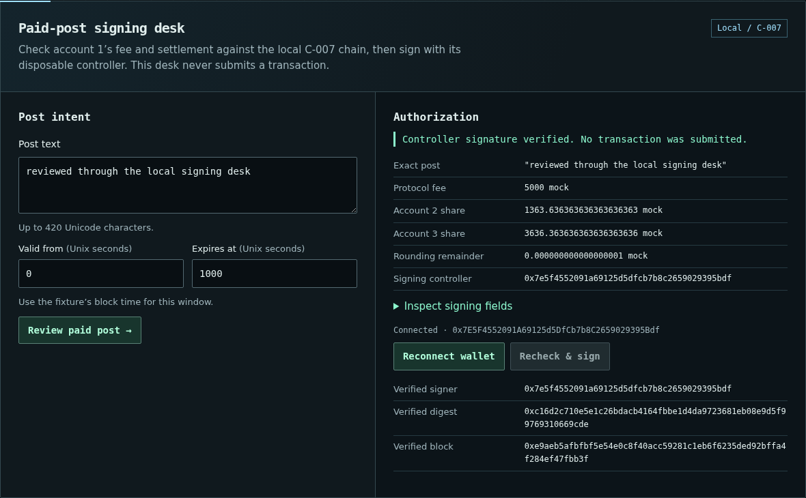

# Review a local paid-post request

The C-007 fixture charges account 1 a fixed 5,000 mock tokens. The owner authorizes the exact post text and stake root for a specific epoch, nonce and validity window. The two successful historical calls use different controllers because account 1 changed hands. This separate research contract has its own signing domain and economics. The running console’s ordinary post remains unpaid.

Run the offline reviewer workflow with `sh integration/local-console/review-paid-post.sh` from the repository root on Node 20.20.2. The individual commands are:

```sh
npm ci --prefix integration/local-console --ignore-scripts
node integration/local-console/paid-post-preview.mjs integration/local-console/paid-post-example.json
node integration/local-console/test-paid-post-preview.mjs
```

The example uses the first successful historical request. The command displays text, fee, digest and complete EIP-712 data offline. The numeric inputs are unsigned decimal strings. Times are Unix seconds. The command accepts caller-provided state and does not establish present ownership, fee affordability, stake eligibility or freshness. It never contacts a wallet. The expected digest for the example is `0xe362f82314cbff5789cf89a332c8a215b179aa60e9716e7cdaba95cf5430b189`.

The regression reads the retained signed transactions and successful receipts, rebuilds each request, and recovers the expected fixture controller from the historical signature. It also checks invalid fields and that changing the text, nonce or stake root changes the digest. This tests compatibility with the historical fixture. The optional live check below reads the signing inputs and expected settlement from a node.

## Repeat the live proof check

Use Linux amd64 with Node.js 20.20.2, npm, Python 3, at least 2 GiB free on the output volume and the pinned [Geth 1.17.10 binary](REPRODUCTION_SETUP.md). Use a new output directory under an existing parent. From the repository root, supply absolute paths:

```sh
sh integration/local-console/review-paid-post.sh --geth /absolute/path/to/geth --output /absolute/path/to/new-result
```

The workflow installs the locked console dependencies, tests the transport and offline preview, verifies the Geth binary and fixture digests, then starts a disposable loopback node. It imports 32 blocks and reads real state proofs with the latest-block selection fixed to historical heights 17 and 31 for comparison. Both reviews match the recorded signing digests. The old review fails after the owner change. Nine rejection cases also cover altered proofs and saved accounting, an expired request, insufficient spendable credit, a wrong chain or genesis, an inconsistent original block and a head change during review. The runner stops its node and leaves `geth.log` and `result.json` in the output directory. [Recorded local result](../evidence/paid-post-live-20261121/result.json).

## Review an intent on a running C-007 fixture

On a local archive node serving the pinned C-007 chain, use the intended text and validity window for that chain's block time. The sample intent belongs to the historical experiment. Prepare the review while account 1 has sufficient unstaked credit. Inspect the returned text, fee, shares, dust, controller and block hash. Recheck the saved file immediately before any separate signing step. Run these commands from the repository root after installing the dependencies:

```sh
node integration/local-console/paid-post-live.mjs prepare http://127.0.0.1:8545 integration/local-console/paid-post-intent.json > review.json
node integration/local-console/paid-post-live.mjs recheck http://127.0.0.1:8545 review.json
```

Both commands fail with a nonzero exit code if verification fails. Check the exit status before using the output. The verifier checks storage proofs against the selected Shanghai header, matches the deployed vault, mock token and wallet code to the pinned fixture, and calculates the settlement from proven balances. On recheck it reconstructs the original review and reacquires current state. The result describes the selected local head. The saved JSON carries no user signature, and the head can advance after a successful recheck. The signing desk below consumes this review. Submission and reproduction by another operator remain open.

## Run the signing desk

Use the Linux, Node and Geth versions listed above. From the repository root, start a disposable C-007 node and the ordinary console together. Choose an output directory that does not yet exist.

```sh
sh integration/local-console/review-paid-post.sh --geth /absolute/path/to/geth --output /absolute/path/to/new-session --serve-console
```

Open the console address printed by the launcher and select **Signing desk**, or append `/#paid-post` to its origin. There are two local chains with ID 31337. Use the **Paid-post wallet RPC** printed for the paid-post fixture. The ordinary account and withdrawal panels use the other RPC. The paid-post node pauses at block 17 with the original contract wallet as owner. For this disposable fixture its controller is `0x7e5f4552091a69125d5dfcb7b8c2659029395bdf` (public test scalar 1). The console never takes a private key. Stop the session with Ctrl+C.

Enter the exact post and an interval in the fixture’s block time. At block 17, **0** and **1000** are a usable start and expiry. Review the fee, both recipient shares and the rounding remainder. Connect the disposable controller and request its signature. The browser checks the wallet’s chain, genesis, selected block and account, and rebuilds the EIP-712 digest. After the prompt it rechecks the state. The server recovers the controller and checks the original signature bytes with the contract wallet’s ERC-1271 method at the reviewed block. A successful result shows the signer, digest and block. Editing the intent or switching wallets clears the review.

The signing action makes no transaction. A signature is an authorization that might still be usable by anyone who already has it while the contract’s conditions hold. The console only returns verification details and keeps the signature out of browser storage and application logs. All results apply to this synthetic fixture.

To repeat the real signature and contract checks headlessly, use a separate new output directory:

```sh
sh integration/local-console/review-paid-post.sh --geth /absolute/path/to/geth --output /absolute/path/to/new-signing-check --signing-test
```

This imports the historical blocks, tests the actual block-17 signing API with a disposable key, and finishes the 32-block replay. To attach the desk to an existing console instead, add `--paid-post-rpc http://127.0.0.1:PORT` to its normal launch command. Only the operator can configure that endpoint. The signing desk stays disabled without it.

### Browser reproduction

With the two-chain console running, use another terminal and an isolated Python environment with Playwright 1.58.0 and its Chromium browser installed. Substitute the two loopback addresses printed by the launcher.

```sh
python3 integration/local-console/test-paid-post-browser.py --console http://127.0.0.1:4200 --rpc http://127.0.0.1:PAID_RPC_PORT --output /absolute/path/to/new-browser-result
```

The browser enters a new post, asks the disposable controller to sign once, and checks the verified signer, digest and block on screen. It also checks that an edit clears the result and that the fixture head stays at block 17. The test uses a browser-injected disposable provider. Extension compatibility and independent reproduction remain open. [Browser result](../evidence/paid-post-signing-20261121/browser-result.json) · [Fresh Geth replay](../evidence/paid-post-signing-20261121/live-result.json) · [Mobile view](../evidence/paid-post-signing-20261121/signing-desk-390.png)


